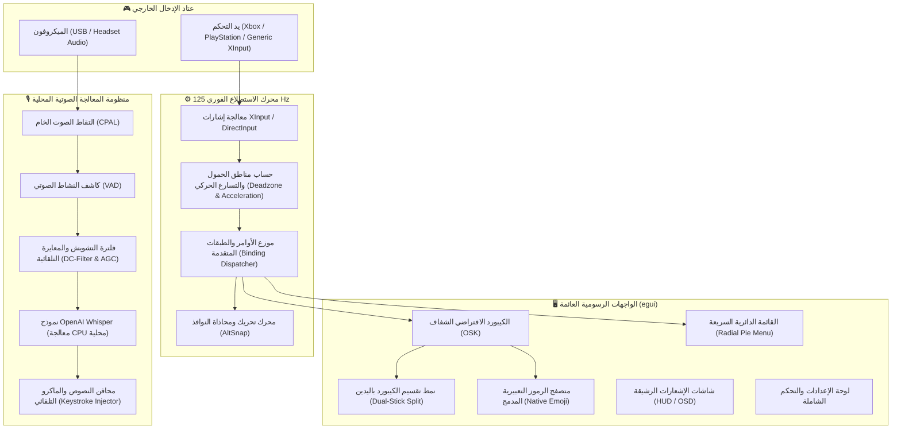

<div align="center">

# 🎮 Reverse Controller
### *النظام الأصلي الأقوى والأشمل للتحكم بسطح المكتب ولوحة المفاتيح الافتراضية بلغة Rust*

[](https://www.rust-lang.org/)
[](https://microsoft.com/windows)
[](https://github.com/m7kor/Reverse-Controller/releases/latest)
[](https://github.com/m7kor/Reverse-Controller)
[](https://github.com/m7kor/Reverse-Controller)
[](LICENSE)

<br/>

**[🇸🇦 العربية (Arabic)](README.ar.md)** • **[English](README.md)** • **[📥 تحميل إصدار v1.2.3](https://github.com/m7kor/Reverse-Controller/releases/latest)** • **[📜 سجل التغييرات الكامل](CHANGELOG.md)** • **[📋 تقرير الفحص والتدقيق الفني](docs/comprehensive_audit_and_fix_report.md)**

---

</div>

> [!TIP]
> **استقلالية تامة عن Steam · ذكاء اصطناعي محلي للكتابة الصوتية بدون إنترنت · استجابة فائقة بتردد 125Hz · كود Rust صافٍ بالكامل**
>
> للإطلاع على سجل التحديثات والميزات الجديدة لكل إصدار بالتفصيل، يُرجى زيارة **[صفحة الإصدارات في GitHub (Releases)](https://github.com/m7kor/Reverse-Controller/releases)** أو مراجعة **[ملف سجل التغييرات (CHANGELOG.md)](CHANGELOG.md)**.

---

## ⚡ التنقل السريع والفهرس

| القسم | الوصف والمحتوى |
| :--- | :--- |
| **[📖 نظرة عامة وفلسفة المشروع](#-نظرة-عامة-وفلسفة-المشروع)** | نبذة عن البرنامج، أهدافه، وأبرز إحصائيات الأداء. |
| **[📊 مقارنة تقنية شاملة](#-مقارنة-تقنية-شاملة-مع-النسخة-التجارية)** | مقارنة تفصيلية بين Reverse Controller وبرنامج Controller Companion التجاري. |
| **[🏛️ المعمارية والمخطط التقني](#️-المعمارية-والمخطط-التقني-للنظام)** | المخطط الهندسي لمحرك 125Hz، واجهات egui، ونموذج الذكاء الاصطناعي. |
| **[🎮 الدليل الشامل لجميع الأزرار](#-الدليل-الشامل-لأزرار-التحكم)** | أوضاع الماوس، الكيبورد الافتراضي، واختصارات النظام السريعة. |
| **[🎙️ منظومة الصوت والماكرو](#4️⃣-منظومة-الكتابة-الصوتية-المحلية-بالذكاء-الاصطناعي-والماكرو)** | الكتابة الصوتية بدون إنترنت وأوامر الترقيم التلقائية وقاموس الكلمات. |
| **[🚀 التشغيل السريع والتحميل](#-التشغيل-السريع-والتحميل-المباشر)** | رابط التحميل الفوري وطريقة التشغيل بدون تثبيت. |
| **[🛠️ البناء والترجمة من المصدر](#️-البناء-والترجمة-من-المصدر)** | متطلبات البيئة وأوامر التجميع واختبارات الأداء. |

---

## 📖 نظرة عامة وفلسفة المشروع

مشروع **Reverse Controller** هو إعادة هندسة وبرمجة شاملة ومفتوحة المصدر بالكامل من الصفر بلغة **Rust 2021** الصافية لبرنامج **Controller Companion** الشهير لنظام Windows.

يمنحك البرنامج تحكماً مطلقاً وفائق السلاسة بسطح المكتب ونوافذ ويندوز عبر أي يد تحكم مفضلة لديك (Xbox Series / One / 360, PlayStation DualSense / DualShock 4, Nintendo Switch Pro, Generic XInput / DirectInput)، مع زمن استجابة شبه معدوم واستغناء كامل عن منصة Steam أو أي خدمات سحابية، مع دعم أصيل واستثنائي للغة العربية.

### 🌟 أبرز الركائز والميزات التقنية:

- ⚡ **أداء خارق واستهلاك موارد شبه معدوم:** استهلاك ذاكرة لا يتجاوز **~24MB** أثناء الخمول (مقارنة بـ 150MB+ للحلول المعتمدة على Electron أو C#)، مع معدل استطلاع عتادي **125Hz** وزمن استجابة فوري أقل من **1.2ms** واستهلاك معالج **<0.2%**.
- 🔒 **خصوصية 100% واستقلالية مطلقة:** لا يجمع أي بيانات ولا يتطلب أي اتصال بالإنترنت. محرك كتابة صوتية محلي بالكامل مدمج بالذكاء الاصطناعي (**OpenAI Whisper**) يعمل مباشرة على المعالج دون الحاجة لخدمات ويندوز الصوتية (Win+H).
- 🖱️ **تحكم هجين سلس:** إمكانية النقر والتفاعل بالفأرة الحقيقية (أو اللمس) مباشرة على أزرار الكيبورد الافتراضي بالتوازي التام مع حركة اليد.
- 🎨 **تصميم زجاجي عصري متناسق مع Windows 11:** واجهات رسومية عائمة مدعومة بكرت الشاشة عبر `egui` بتأثيرات Acrylic و Mica وخاصية التفاعل الصوتي الميكانيكي الفوري.
- 🌐 **دعم لغوي عربي وإنجليزي متقدم:** معالجة كاملة للنصوص ثنائية الاتجاه (BiDi) وتشكيل الحروف العربية مع تفادي نافذة المؤشر تلقائياً.
- 🛡️ **استقرار واعتمادية موثقة:** اجتياز **131 اختبار وحدة** بنسبة نجاح 100% وخلو تام من أي أخطاء أو تحذيرات تحليل ساكن (Zero Clippy Warnings).

---

## 📊 مقارنة تقنية شاملة مع النسخة التجارية

| المعيار التقني | Controller Companion التجاري (Original) | Reverse Controller (Rust Edition) |
| :--- | :--- | :--- |
| **لغة البرمجة والمعمارية** | C# / .NET Framework 4.x القديم | **Rust 2021 الصافية (Native Safe Code بدون بيئة تشغيل)** |
| **التبعية لمنصة Steam** | إجبارية (يتطلب تشغيل عميل Steam دائماً) | **منعدمة 100% (يعمل مستقلاً كملف تنفيذي محمول وخفيف)** |
| **دعم اللغة العربية** | غير مدعوم أو تظهر الحروف مقلوبة ومتقطعة | **دعم كامل من اليمين لليسار (BiDi) مع التشكيل والهمزات** |
| **الكتابة الصوتية (Voice Typing)** | يعتمد على نافذة ويندوز السحابية (Win+H) | **محلي 100% بالذكاء الاصطناعي (Whisper CPU) بدون إنترنت** |
| **استهلاك الذاكرة (RAM)** | 85MB ~ 160MB | **24MB ~ 29MB فقط (مع تفريغ دوري ذكي لذاكرة العمل)** |
| **زمن استجابة الإدخال (Latency)** | ~8ms – 16ms | **أقل من 1.2ms (استطلاع XInput فائق الدقة 125Hz)** |
| **متصفح الإيموجي (Emoji Picker)** | يفتح نافذة ويندوز الثقيلة (Win + .) | **متصفح إيموجي خفيف مدمج داخل لوحة المفاتيح مصنف بالفئات** |
| **تحريك الكيبورد (Repositioning)** | غير متوفر عبر اليد بسلاسة | **تحريك حر بالقير الأيمن بضغطة واحدة (R3 Reposition)** |
| **كيبورد القيرين المنقسم** | غير متوفر | **متوفر بنمط Steam Deck Split Keyboard (L3 + R3)** |
| **زر مخصص للسطر الجديد (Shift+Enter)** | غير مدعوم | **زر مخصص `⇧↵` داخل الكيبورد + اختصار يدوي `RT + Start`** |
| **التفاعل بالفأرة الحقيقية** | محدود أو يسبب وميضاً للنوافذ | **دعم كامل للنقر بالماوس أو شاشات اللمس على الكيبورد** |
| **أدوات التحرير (Edit Tools Layer)** | غير متوفرة | **لوحة متكاملة للنسخ، اللصق، القص، التراجع، وتحديد الكل** |
| **الترخيص والكود المصدري** | احتكاري مغلق المصدر (مدفوع) | **مفتوح المصدر بالكامل ومجاني برخصة MIT** |

---

## 🏛️ المعمارية والمخطط التقني للنظام



---

## 🎮 الدليل الشامل لأزرار التحكم

### 1️⃣ وضع الماوس لسطح المكتب (Desktop Mouse Mode)

الوضع الافتراضي عند تشغيل البرنامج واستخدام اليد للتصفح العادي وإدارة الملفات وتشغيل الوسائط:

| الزر في اليد | الوظيفة | الشرح والتفاصيل |
| :--- | :--- | :--- |
| **🕹️ الأنالوج الأيسر (Left Stick)** | **تحريك مؤشر الماوس** | حركة انسيابية فائقة مع تسارع حركي ديناميكي وتثبيط لارتجاف اليد. |
| **🕹️ الأنالوج الأيمن (Right Stick)** | **عجلة التمرير (Scroll Wheel)** | تمرير عمودي وأفقي ناعم جداً لتصفح المستندات والمواقع. |
| **🟢 زر A** | **النقر الأيسر (Left Click)** | النقر الأساسي، النقر المزدوج، سحب النوافذ، وفتح الروابط. |
| **🔵 زر X** | **النقر الأيمن (Right Click)** | فتح القوائم الجانبية (Context Menu) وخيارات الملفات. |
| **🔴 زر B** | **المسح والرجوع (Backspace)** | مسح الحرف السابق أثناء الكتابة أو الرجوع خطوة للخلف في المتصفح. |
| **🟡 زر Y** | **تشغيل / إيقاف الوسائط (Play/Pause)** | تحكم فوري بتشغيل أو إيقاف الموسيقى والفيديوهات (Spotify, YouTube, VLC). |
| **🔘 ضغطة R3 (الأنالوج الأيمن)** | **الزر الأوسط للماوس (Middle Click)** | إغلاق تبويبات المتصفح بنقرة واحدة، أو تفعيل التمرير التلقائي. |
| **🔘 ضغطة L3 (الأنالوج الأيسر)** | **إظهار / إخفاء الكيبورد (Toggle OSK)** | استدعاء أو إغلاق لوحة المفاتيح الافتراضية العائمة الشفافة فوراً. |
| **🎯 الزناد الأيسر (LT)** | **نمط القناص الدقيق (Sniper Mode)** | الضغط عليه يبطئ حركة الماوس بنسبة تصل إلى 70% للتحكم المليمتري الدقيق. |
| **⚡ الزناد الأيمن (RT)** | **مفتاح Shift (Shift Modifier)** | يعمل كزر `Shift` لتحديد النصوص أو اختيار عناصر متعددة. |
| **⏮️ الكتف الأيسر (LB)** | **المقطع السابق (Previous Media)** | الانتقال للمقطع أو الأغنية السابقة. |
| **⏭️ الكتف الأيمن (RB)** | **المقطع التالي (Next Media)** | الانتقال للمقطع أو الأغنية التالية. |
| **🎛️ أزرار الأسهم (D-Pad)** | **مفاتيح الأسهم (Arrow Keys)** | التنقل بالأسهم في جميع الاتجاهات مع خاصية التكرار السريع عند الاستمرار بالضغط. |
| **▶️ زر Start** | **زر الإدخال (Enter)** | فتح البرامج، إرسال الرسائل، أو إدراج سطر جديد. |
| **📋 زر Back** | **مفتاح الطبقة المتقدمة (Modifier)** | عند تعليق الضغط عليه، يفعل الاختصارات الثانوية المتقدمة للنظام. |
| **🌐 زر Xbox Guide** | **قائمة ابدأ / إطفاء اليد** | نقرة سريعة تفتح قائمة ابدأ؛ وتعليق الضغط لمدة 2.5 ثانية يطفئ اليد اللاسلكية فوراً لحفظ البطارية. |

---

### 2️⃣ أزرار الكيبورد الافتراضي الشفاف (اضغط L3 لفتح الكيبورد)

عند الضغط على **L3** تظهر لوحة المفاتيح العائمة، وتتحول اليد فوراً إلى وضع الكتابة الاحترافي المخصص:

| الزر في اليد | الوظيفة المخصصة في الكيبورد |
| :--- | :--- |
| **🕹️ الأنالوج الأيسر أو D-Pad** | **تحريك المؤشر بين الحروف** بسلاسة تامة في جميع الاتجاهات الثمانية. |
| **🟢 زر A** | **طباعة الحرف أو الرمز المحدد** مع صوت نقرة ميكانيكية تفاعلية واهتزاز خفيف. |
| **🔵 زر X** | **مسح الحرف السابق (Backspace)** مع تسارع مستمر في سرعة المسح عند تعليق الضغط. |
| **🟡 زر Y** | **مسافة (Space Bar)** مع استمرار التباعد التلقائي عند تعليق الضغط. |
| **🔴 زر B** | **إغلاق الكيبورد فوراً** والرجوع المباشر لسطح المكتب. |
| **⏮️ الكتف الأيسر L1 (LB)** | **تحريك مؤشر الكتابة لليمين (Caret Right ➔)** لتعديل الكلمات وتصحيح النصوص بسرعة. |
| **⏭️ الكتف الأيمن R1 (RB)** | **تحريك مؤشر الكتابة لليسار (Caret Left ⬅)** مع خاصية التكرار المستمر. |
| **🎯 الزناد الأيسر L2 (LT)** | **الانتقال لطبقة الأرقام والرموز والأشكال** (`?123` / `#+=`). |
| **⚡ الزناد الأيمن R2 (RT)** | **تكبير الحروف والتشكيل** (الحركات والهمزات العربية، وحروف Capital في الإنجليزية). |
| **🔘 ضغطة R3 (الأنالوج الأيمن)** | **تفعيل وضع تحريك الكيبورد (Reposition Mode):** اضغط R3، ثم حرّك الكيبورد بالقير الأيمن في أي مكان على الشاشة، ثم اضغط R3 مجدداً لتثبيت مكانه الجديد! |
| **🔘 ضغطة L3 (الأنالوج الأيسر)** | **إخفاء الكيبورد فوراً**. |
| **🎮 L3 + R3 معاً** | **تبديل نمط الشطرين (Dual-Stick Split Mode):** تقسيم الكيبورد لنصفين للكتابة بالإبهامين معاً (بنمط Steam Deck). |
| **📋 زر Back** | **تبديل اللغة فوراً** بين العربية والإنجليزية (`AR ⇋ EN`). |
| **▶️ زر Start** | **زر الإدخال الافتراضي (Enter)**. |
| **⚡ الزناد RT + زر Start** | **اختصار Shift + Enter السريع:** إدراج سطر جديد في تطبيقات المحادثة (Discord, WhatsApp, Telegram, ChatGPT) دون إرسال الرسالة بالخطأ! |
| **⇧↵ زر الشفت وانتر في الكيبورد** | **مفتاح Shift+Enter مخصص:** موجود في الصف السفلي بجانب النقطة لإدراج أسطر جديدة فوراً باليد أو بالماوس. |
| **🖱️ النقر بالماوس على الكيبورد** | **دعم الفأرة الحقيقية واللمس:** يمكنك النقر مباشرة بالماوس على أي زر في الكيبورد بالتزامن مع استخدام اليد. |
| **🛠️ زر Edit في الكيبورد** | **فتح لوحة أدوات التحرير المدمجة:** نسخ، لصق، قص، تراجع، إعادة، مسح كلمة، وتحديد الكل. |
| **😀 زر الإيموجي في الكيبورد** | **فتح متصفح الرموز التعبيرية المدمج** المستقل بالكامل والمصنف حسب الفئات. |

---

### 3️⃣ طبقة الاختصارات المتقدمة (Back Modifier Layer: تعليق الضغط على Back)

عند تعليق الضغط على **زر Back**، تتحول باقي الأزرار إلى مركز تحكم شامل بويندوز:

| الاختصار | الوظيفة | الشرح والتفاصيل |
| :--- | :--- | :--- |
| **Back + Start** | **تشغيل / إيقاف تحكم اليد** | مفتاح أمان عتادي فوري لتعطيل أو تمكين تحكم اليد في أي لحظة. |
| **Back + LB (الكتف الأيسر)** | **الكتابة الصوتية بالذكاء الاصطناعي** | تسجيل صوتك وتحويله لنص عربي أو إنجليزي محلياً بدون إنترنت عبر Whisper. |
| **Back + R3 (ضغطة الأنالوج الأيمن)** | **القائمة الدائرية السريعة (Radial Menu)** | يفتح قائمة دائرية سريعة بـ 8 اتجاهات للتنقل السريع بين البرامج. |
| **Back + L3 (ضغطة الأنالوج الأيسر)** | **قفل السحب والإفلات (Drag Lock)** | تعليق زر الماوس الأيسر تلقائياً لسحب النوافذ والملفات دون استمرار الضغط. |
| **Back + D-Pad ⬆️ / ⬇️** | **التحكم بمستوى الصوت** | زيادة أو خفض صوت النظام مع مؤشر OSD مرئي وتأثير صوتي تفاعلي. |
| **Back + D-Pad ⬅️ / ➡️** | **محاذاة النوافذ لليسار / اليمين** | محاذاة وتثبيت النافذة النشطة لنصف الشاشة (Win + Left / Right). |
| **Back + 🔴 زر B** | **زر الهروب (Escape)** | إغلاق النوافذ المنبثقة، القوائم الجانبية، أو الخروج من وضع ملء الشاشة. |
| **Back + 🔵 زر X** | **إظهار سطح المكتب (Show Desktop)** | تصغير جميع النوافذ فوراً والرجوع لسطح المكتب (Win + D). |
| **Back + RB (الكتف الأيمن)** | **مبدل المهام (Alt + Tab)** | استدعاء مبدل النوافذ مع تنقل سلس بالأسهم واهتزاز تفاعلي. |

---

### 4️⃣ منظومة الكتابة الصوتية المحلية بالذكاء الاصطناعي والماكرو

يتميز Reverse Controller بمنظومة ذكاء اصطناعي مدمجة ومحلية بالكامل لتحويل الصوت إلى نصوص عبر **OpenAI Whisper** تعمل بالكامل على المعالج دون إرسال أي بايت للسحابة:

- **ماكرو الإرسال التلقائي الذكي:** قل **"أرسل"** أو **"إرسال"** أو **"انتر"** (أو بالإنجليزية: **"send"** / **"Send"**) في نهاية جملتك ليتم كتابة الكلام وضغط زر Enter تلقائياً لإرسال الرسالة في برامج المحادثة!
- **إدراج سطر جديد بالصوت:** قل **"سطر جديد"** أو **"new line"** للانتقال إلى الفقرة التالية فوراً.
- **أوامر الترقيم التلقائية المدعومة:**
  - *"فاصلة"* ⇦ `،`
  - *"فاصلة منقوطة"* ⇦ `؛`
  - *"نقطة"* ⇦ `.`
  - *"نقطتان"* أو *"نقطتين"* ⇦ `:`
  - *"علامة استفهام"* ⇦ `؟`
  - *"علامة تعجب"* ⇦ `!`
  - *"بين قوسين"* ⇦ `()`
  - *"شرطة"* ⇦ `-`
  - *"خط مائل"* ⇦ `/`
- **قاموس المصطلحات والأسماء المخصصة (Vocabulary Biasing):** يمكنك من واجهة الإعدادات (تبويب **Voice & AI**) إضافة أسمائك الخاصة أو مصطلحات ألعابك ومجتمعك (مثل: *"فيفا"*، *"فورتنايت"*، *"ديسكورد"*، *"Rust"*) لتهيئة أوزان التعرف في Whisper وضمان دقة التعرف بنسبة 100%.

---

## 🚀 التشغيل السريع والتحميل المباشر

البرنامج محمول (Portable) بالكامل ولا يتطلب أي تثبيت أو برامج مساعدة:

```
┌────────────────────────────────────────────────────────────────────────┐
│  🚀 تشغيل مباشر بدون فك ضغط: ReverseController.exe (8.4 MB)           │
│  📦 حزمة مضغوطة محمولة:      ReverseController-v1.2.3-windows-x64.zip  │
│  👉 https://github.com/m7kor/Reverse-Controller/releases/latest         │
└────────────────────────────────────────────────────────────────────────┘
```

1. **التحميل:** حمّل الحزمة المحمولة الجاهزة من **[صفحة الإصدارات في GitHub](https://github.com/m7kor/Reverse-Controller/releases/latest)**.
2. **فك الضغط:** استخرج محتويات الملف المضغوط في أي مجلد تريده.
3. **التشغيل:** شغّل ملف `ReverseController.exe` (لا يحتاج صلاحيات مسؤول ولا يتطلب أي رن تايم خارجي).
4. **التوصيل:** وصّل يد التحكم الخاصة بك واستمتع بالتجربة الكاملة.
5. **أيقونة شريط المهام (System Tray):**
   - **نقرة بالزر الأيسر:** تفتح لوحة الإعدادات الشاملة (منحنيات الماوس، مناطق الخمول، تفضيلات الكيبورد، معايرة الذكاء الاصطناعي، والبروفايلات).
   - **نقرة بالزر الأيمن:** تفتح القائمة السريعة لتشغيل/إيقاف التحكم، إعادة التشغيل، أو الخروج.

---

## 🛠️ البناء والترجمة من المصدر

### المتطلبات الأساسية:
- نظام Windows 10 أو Windows 11 (x64)
- بيئة [Rust Toolchain (MSVC Stable)](https://rustup.rs/)
- حزمة Visual Studio C++ Build Tools مع CMake و LLVM/libclang لترجمة معالج الذكاء الاصطناعي Whisper.

```powershell
# استنساخ المستودع الرئيسي
git clone https://github.com/m7kor/Reverse-Controller.git
cd Reverse-Controller

# بناء النسخة المحسنة للإنتاج مع Link-Time Optimization (LTO)
cargo build --release --features "gui,voice"

# تشغيل حزمة الاختبارات الشاملة (131 اختبار وحدة)
cargo test --features "gui,voice"

# التحقق من خلو الكود من أي تحذيرات عبر Clippy
cargo clippy --all-targets --features "gui,voice" -- -D warnings
```

الملف التنفيذي الناتج بعد الترجمة سيكون متوفراً في المسار:
`target/release/ReverseController.exe`

---

## ⚙️ ملفات الإعدادات والبروفايلات

تُحفظ جميع إعدادات البرنامج، ومنحنيات حركة الفأرة، ومناطق الخمول (Dead Zones)، وقاموس الكلمات الصوتي بصيغة JSON قياسية في المسار التالي:
`%APPDATA%\ControllerCompanionRust\config.json`

### التوافق مع AntiMicroX:
يدعم البرنامج استيراد ملفات البروفايلات بامتداد `.amgp` مباشرة من واجهة الإعدادات مع تحويل تلقائي لبنية الملفات دون أي عناء.

---

## 📜 الترخيص والحقوق

هذا المشروع مرخص ومتاح بالكامل تحت رخصة **MIT License**. للاطلاع على نص الرخصة الكامل، راجع ملف [LICENSE](LICENSE).
