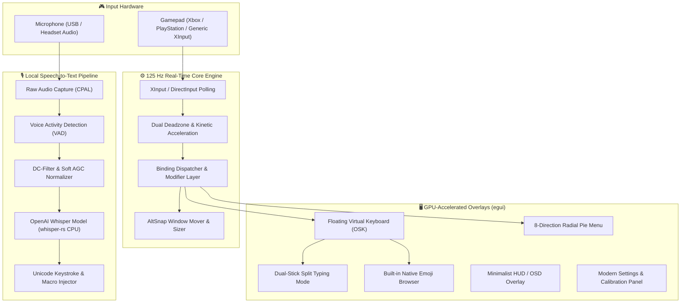

<div align="center">

# 🎮 Reverse Controller
### *The Ultimate Native Rust Gamepad Navigation & Virtual Keyboard System*

[](https://www.rust-lang.org/)
[](https://microsoft.com/windows)
[](https://github.com/m7kor/Reverse-Controller/releases/latest)
[](https://github.com/m7kor/Reverse-Controller)
[](https://github.com/m7kor/Reverse-Controller)
[](LICENSE)

<br/>

**[English](README.md)** • **[🇸🇦 العربية (Arabic)](README.ar.md)** • **[📥 Download v1.2.3](https://github.com/m7kor/Reverse-Controller/releases/latest)** • **[📜 Changelog](CHANGELOG.md)** • **[📋 Audit Report](docs/comprehensive_audit_and_fix_report.md)**

---

</div>

> [!TIP]
> **Zero Steam Dependency · 100% Offline AI Voice Dictation · Sub-millisecond 125Hz Polling · Pure Native Rust**
>
> For version release notes and update archives, visit the **[GitHub Releases Page](https://github.com/m7kor/Reverse-Controller/releases)** or consult the **[CHANGELOG.md](CHANGELOG.md)**.

---

## ⚡ Quick Navigation

| Section | Description |
| :--- | :--- |
| **[📖 About](#-about-the-project)** | Overview, philosophy, and performance metrics. |
| **[📊 Comparison](#-technical-comparison)** | Reverse Controller vs commercial Controller Companion. |
| **[🏛️ Architecture](#️-system-architecture)** | Core engine, GPU overlay, and Whisper AI pipeline. |
| **[🎮 Controls Guide](#-complete-controller-mapping-guide)** | Desktop mouse, virtual keyboard, and system shortcuts. |
| **[🎙️ Voice Dictation](#4️⃣-offline-ai-voice-dictation--natural-macros)** | Offline speech-to-text and voice punctuation macros. |
| **[🚀 Getting Started](#-quick-start)** | Instant download and portable execution. |
| **[🛠️ Building from Source](#️-building-from-source)** | Prerequisites and compilation instructions. |

---

## 📖 About The Project

**Reverse Controller** is a high-performance, open-source reimplementation of the classic **Controller Companion** desktop navigation utility, built from the ground up in safe, concurrent **Rust 2021**.

It seamlessly transforms any standard gamepad (Xbox Series / One / 360, PlayStation DualSense / DualShock 4, Nintendo Switch Pro, or generic XInput / DirectInput controllers) into an ultra-responsive desktop mouse and keyboard with sub-millisecond precision — without Steam, background bloat, or cloud dependencies.

### 🌟 Key Highlights

- ⚡ **Ultra-Lightweight & Blazing Fast:** Idles at **~24MB RAM** (vs 150MB+ for .NET / Electron utilities) with **<0.2% CPU** usage during 125Hz polling and **<1.2ms** input latency.
- 🔒 **100% Offline & Private:** Zero cloud telemetry or external runtime dependencies. Local **OpenAI Whisper AI** provides speech-to-text directly on the CPU without Windows Voice Typing (Win+H).
- 🖱️ **Hybrid Control:** Full support for physical mouse clicks on virtual keyboard buttons alongside instantaneous controller grid navigation.
- 🎨 **Modern Fluent 2 Aesthetics:** GPU-accelerated translucent overlay rendered via `egui` with Windows 11 Acrylic / Mica glass effects, interactive visualizers, and tactile audio feedback.
- 🌐 **First-Class Bilingual Typing:** Native Arabic (RTL, contextual reshaping, diacritics/tashkeel) and English QWERTY layouts with automatic text caret avoidance and caret navigation triggers.
- 🛡️ **Tested & Verified:** 131 unit tests with 100% pass rate and 0 Clippy linter warnings.

---

## 📊 Technical Comparison

| Feature | Original Controller Companion (Commercial) | Reverse Controller (Rust Edition) |
| :--- | :--- | :--- |
| **Language & Architecture** | C# / .NET Framework 4.x | **Pure Native Rust 2021 (Zero Runtime)** |
| **Steam Dependency** | Required (Must run via Steam client) | **None (Fully standalone, portable executable)** |
| **Voice Dictation** | Relies on Windows Online Voice (Win+H) | **100% Local Whisper AI (CPU Inference, Zero Cloud)** |
| **Arabic & RTL Support** | Broken / missing characters / reversed text | **Complete Bidirectional (BiDi) + Tashkeel + Reshaping** |
| **Idle Memory (RAM)** | 85MB – 160MB | **24MB – 29MB (Periodic WorkingSet trimming)** |
| **Input Latency** | ~8ms – 16ms | **< 1.2ms (125 Hz XInput engine)** |
| **Emoji Browser** | Triggers Windows OS Flyout (Win + .) | **Lightweight Native Categorized Emoji Browser** |
| **Keyboard Repositioning** | Clunky manual mouse dragging | **One-Touch R3 Analog Repositioning Across Screens** |
| **Split-Stick Typing** | Not Supported | **Dual-Stick Steam Deck-Style Split Mode (L3+R3)** |
| **Dedicated Shift+Enter** | Not Supported | **Dedicated `⇧↵` Key + `RT + Start` Gamepad Shortcut** |
| **Mouse Interaction** | Limited / conflicts with overlay | **Full Physical Mouse & Touch Key Support** |
| **Edit Tools Layer** | None | **Dedicated layer for Copy, Paste, Cut, Undo, Select All** |
| **Source Code & License** | Proprietary Commercial | **100% Free & Open Source (MIT License)** |

---

## 🏛️ System Architecture



---

## 🎮 Complete Controller Mapping Guide

### 1️⃣ Desktop Mouse Mode (Default)

Active during everyday desktop browsing, file management, and media playback:

| Controller Button | Action | Description |
| :--- | :--- | :--- |
| **🕹️ Left Stick** | **Mouse Pointer Move** | Kinetic analog motion with deadzone dampening and acceleration. |
| **🕹️ Right Stick** | **Mouse Scroll Wheel** | Ultra-smooth vertical and horizontal scrolling across documents and web pages. |
| **🟢 Button A** | **Left Click** | Primary click, double-click, window drag, and link selection. |
| **🔵 Button X** | **Right Click** | Context menu and secondary commands. |
| **🔴 Button B** | **Backspace** | Deletes the previous character or navigates backward in browser history. |
| **🟡 Button Y** | **Play / Pause Media** | Instant playback toggle for Spotify, YouTube, VLC, and media players. |
| **🔘 R3 (Right Stick Click)** | **Middle Click** | Closes browser tabs in one click or activates auto-scroll. |
| **🔘 L3 (Left Stick Click)** | **Toggle Keyboard (OSK)** | Summons or dismisses the floating on-screen keyboard. |
| **🎯 Left Trigger (LT)** | **Sniper Precision Mode** | Squeezing LT slows mouse speed by up to 70% for sub-pixel precision. |
| **⚡ Right Trigger (RT)** | **Shift Modifier** | Acts as `Shift` key for multi-item selection and text highlighting. |
| **⏮️ Left Shoulder (LB)** | **Previous Track** | Skips to previous media track. |
| **⏭️ Right Shoulder (RB)** | **Next Track** | Skips to next media track. |
| **🎛️ D-Pad (Arrows)** | **Arrow Keys** | Discrete cursor navigation with auto-repeat on hold. |
| **▶️ Start Button** | **Enter Key** | Submits dialogs, launches selected shortcuts, or inserts newlines. |
| **📋 Back Button** | **Modifier Layer** | Hold down to activate the secondary system shortcuts layer. |
| **🌐 Xbox Guide Button** | **Start Menu / Turn Off** | Tap opens the Windows Start Menu; holding for 2.5s powers off wireless gamepads. |

---

### 2️⃣ Virtual Keyboard Mode (Press L3 to Open)

Pressing **L3** surfaces the floating keyboard overlay, repurposing your controller into an optimized typing apparatus:

| Controller Input | Custom Keyboard Action |
| :--- | :--- |
| **🕹️ Left Stick or D-Pad** | **Navigate Grid Cursor** smoothly across keys in all 8 directions. |
| **🟢 Button A** | **Type Character / Select Key** with tactile mechanical audio feedback. |
| **🔵 Button X** | **Backspace** with accelerating deletion speed on sustained hold. |
| **🟡 Button Y** | **Spacebar** with continuous spacing on hold. |
| **🔴 Button B** | **Dismiss Keyboard** and return directly to desktop mode. |
| **⏮️ Left Bumper L1 (LB)** | **Move Caret Right (→)** across text fields for fast typo navigation. |
| **⏭️ Right Bumper R1 (RB)** | **Move Caret Left (←)** across text fields with continuous auto-repeat. |
| **🎯 Left Trigger L2 (LT)** | **Switch to Numbers & Symbols Layer** (`?123` / `#+=`). |
| **⚡ Right Trigger R2 (RT)** | **Capitalize / Shift / Diacritics** (Tashkeel in Arabic, uppercase in English). |
| **🔘 R3 (Right Stick Click)** | **Reposition Mode:** Click R3 to activate, freely move the keyboard with the Right Stick anywhere on screen, and click R3 again to lock! |
| **🔘 L3 (Left Stick Click)** | **Dismiss Keyboard** immediately. |
| **🎮 L3 + R3 Together** | **Toggle Dual-Stick Split Mode:** Splits the keyboard into two halves for simultaneous two-thumb typing (Steam Deck layout). |
| **📋 Back Button** | **Toggle Language** instantly between Arabic and English (`AR ⇋ EN`). |
| **▶️ Start Button** | **Enter / Submit** (Standard Enter key). |
| **⚡ RT + Start** | **Shift + Enter:** Inserts newlines in Discord, WhatsApp, Telegram, ChatGPT without sending! |
| **⇧↵ Button on Keyboard** | **Dedicated Shift+Enter Key:** Placed on the bottom row next to period for direct newline injection via controller or mouse click. |
| **🛠️ Edit Button on Keyboard** | **Open Edit Tools Layer:** Copy, Paste, Cut, Undo, Redo, Select All, and Clear Word. |
| **😀 Emoji Button on Keyboard** | **Open Native Emoji Browser:** Categorized offline emoji picker. |

---

### 3️⃣ Secondary System Shortcuts (Back Modifier Layer: Hold Back Button)

Holding the **Back button** turns your controller into a full Windows command center:

| Combination | Action | Description |
| :--- | :--- | :--- |
| **Back + Start** | **Toggle Desktop Control** | Hardware-level killswitch to enable or disable gamepad input at any time. |
| **Back + LB (Left Bumper)** | **AI Voice Dictation** | Starts local Whisper AI voice typing (offline, privacy-preserving). |
| **Back + R3 (Right Stick)** | **Radial Pie Menu** | Opens the 8-directional radial menu for fast application switching. |
| **Back + L3 (Left Stick)** | **Drag Lock** | Toggles persistent mouse left-click hold for effortless window dragging. |
| **Back + D-Pad ⬆️ / ⬇️** | **Volume Control** | Adjusts system volume up/down with on-screen OSD HUD and tick audio. |
| **Back + D-Pad ⬅️ / ➡️** | **Snap Window Left / Right** | Snaps the active window to screen halves (Win + Left / Right). |
| **Back + 🔴 Button B** | **Escape (Esc)** | Closes modals, context menus, or exits fullscreen. |
| **Back + 🔵 Button X** | **Show Desktop** | Minimizes all open windows immediately (Win + D). |
| **Back + RB (Right Bumper)** | **Task Switcher (Alt + Tab)** | Surfaces the Windows task switcher with haptic feedback. |

---

### 4️⃣ Offline AI Voice Dictation & Natural Macros

Reverse Controller features an embedded, offline speech-to-text pipeline powered by **OpenAI Whisper** running entirely on the CPU:

- **Automatic Send Macro:** Say **"send"**, **"Send"**, or **"ارسل"** / **"إرسال"** / **"انتر"** at the end of your sentence to automatically type the text and hit Enter!
- **Spoken Newlines:** Say **"new line"**, **"newline"**, or **"سطر جديد"** to cleanly break to the next paragraph.
- **Natural Punctuation Commands:**
  - *"comma"* / *"فاصلة"* ⇦ `,` / `،`
  - *"semicolon"* / *"فاصلة منقوطة"* ⇦ `;` / `؛`
  - *"period"* / *"نقطة"* ⇦ `.`
  - *"colon"* / *"نقطتان"* ⇦ `:`
  - *"question mark"* / *"علامة استفهام"* ⇦ `?` / `؟`
  - *"exclamation mark"* / *"علامة تعجب"* ⇦ `!`
  - *"parentheses"* / *"بين قوسين"* ⇦ `()`
  - *"dash"* / *"شرطة"* ⇦ `-`
  - *"slash"* / *"خط مائل"* ⇦ `/`
- **Custom Vocabulary Biasing:** Add your custom names, gamer tags, or technical slang (e.g., *"Discord"*, *"Fortnite"*, *"Rust"*, *"FIFA"*) in the **Voice & AI** settings tab to prime Whisper's token priors for 100% recognition accuracy.

---

## 🚀 Quick Start

Reverse Controller is completely portable and requires zero installation:

```
┌────────────────────────────────────────────────────────────────────────┐
│  🚀 Direct Executable: ReverseController.exe (8.4 MB - Ready to Run)   │
│  📦 Portable Package:  ReverseController-v1.2.3-windows-x64.zip (3.3 MB)│
│  👉 https://github.com/m7kor/Reverse-Controller/releases/latest         │
└────────────────────────────────────────────────────────────────────────┘
```

1. **Download:** Grab the latest portable package from **[GitHub Releases](https://github.com/m7kor/Reverse-Controller/releases/latest)**.
2. **Extract:** Unzip to any folder of your choice.
3. **Launch:** Run `ReverseController.exe` (no admin rights or external runtimes required).
4. **Enjoy:** Connect any Xbox, PlayStation, or generic gamepad.
5. **System Tray Integration:**
   - **Left-Click Tray Icon:** Opens the comprehensive Settings Panel (Pointer curves, Deadzones, Keyboard prefs, Voice & AI calibration, Profiles).
   - **Right-Click Tray Icon:** Opens the Quick Menu to toggle control on/off, restart, or quit.

---

## 🛠️ Building From Source

### Prerequisites:
- Windows 10 or Windows 11 (x64)
- [Rust Toolchain (MSVC Stable)](https://rustup.rs/)
- Visual Studio C++ Build Tools with CMake and LLVM/libclang (required for compiling Whisper CPU inference bindings).

```powershell
# Clone the repository
git clone https://github.com/m7kor/Reverse-Controller.git
cd Reverse-Controller

# Build the release binary with Link-Time Optimization (LTO)
cargo build --release --features "gui,voice"

# Run the test suite (131 tests)
cargo test --features "gui,voice"

# Run strict Clippy lint verification (Zero Warnings)
cargo clippy --all-targets --features "gui,voice" -- -D warnings
```

The optimized production binary will be generated at:
`target/release/ReverseController.exe`

---

## ⚙️ Configuration & Profiles

All settings, mouse curves, analog deadzones, and custom vocabulary are persisted in standard JSON format at:
`%APPDATA%\ControllerCompanionRust\config.json`

### AntiMicroX Compatibility:
Reverse Controller natively supports importing `.amgp` profile files directly through the Settings UI with automatic XML/JSON schema translation.

---

## 📜 License

This project is licensed under the **MIT License**. See the [LICENSE](LICENSE) file for complete details.
